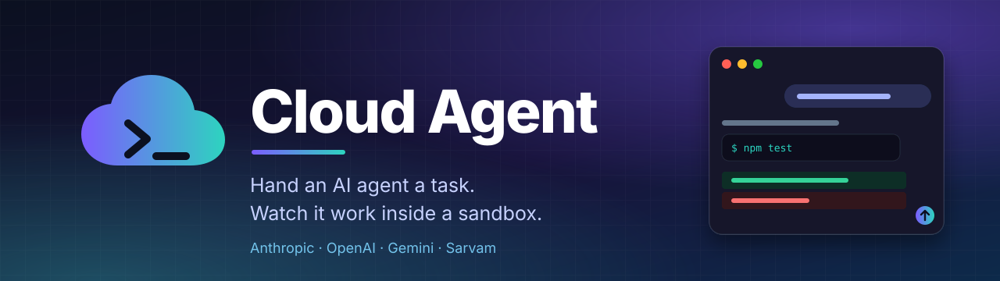
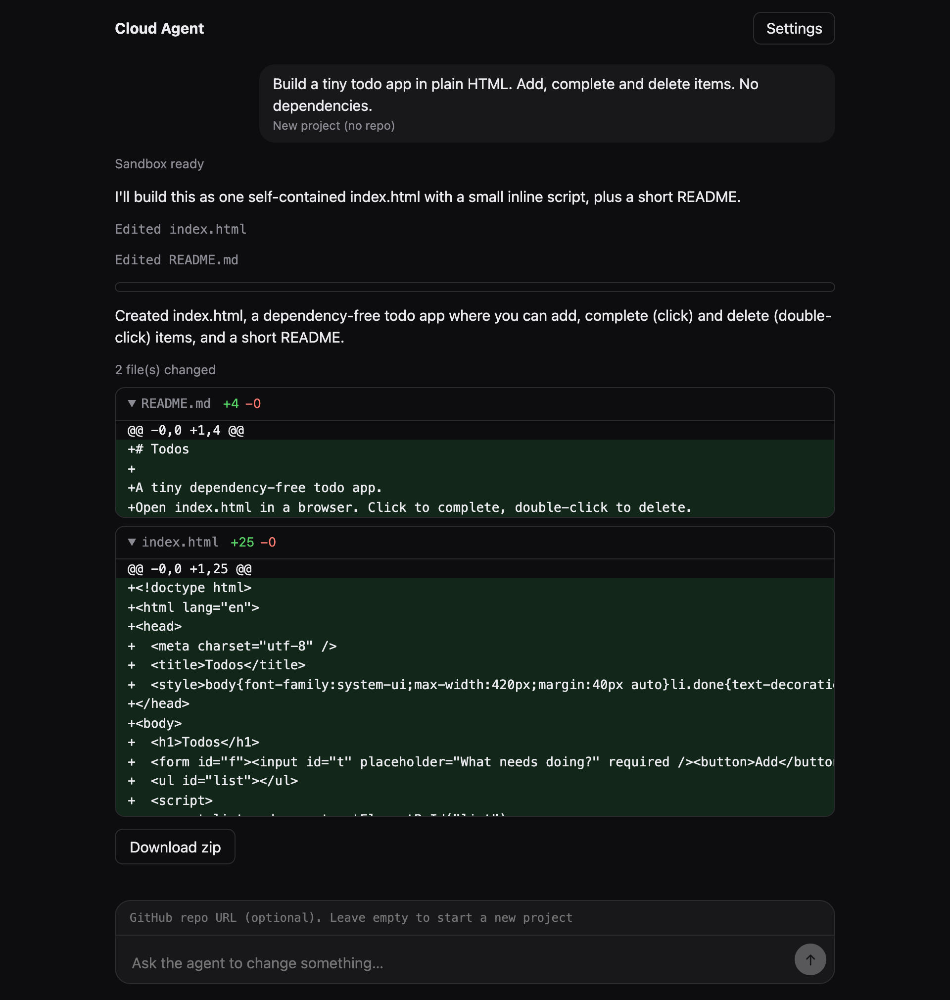
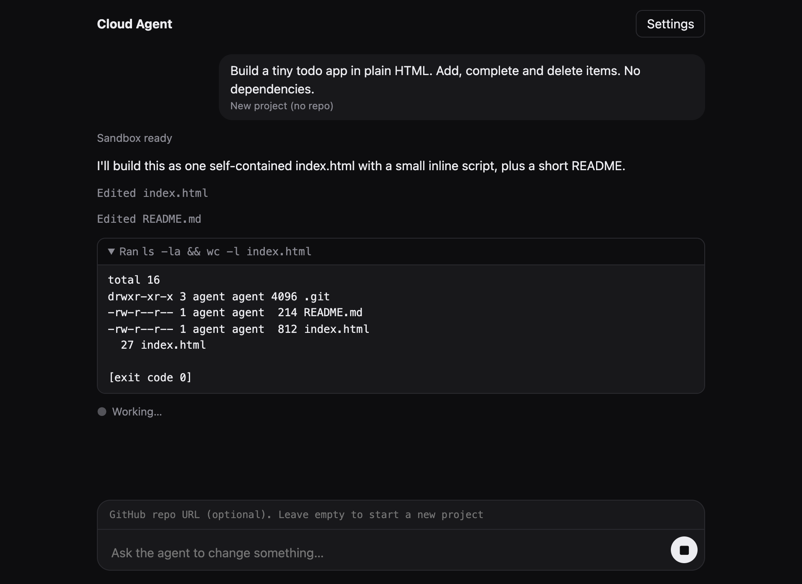
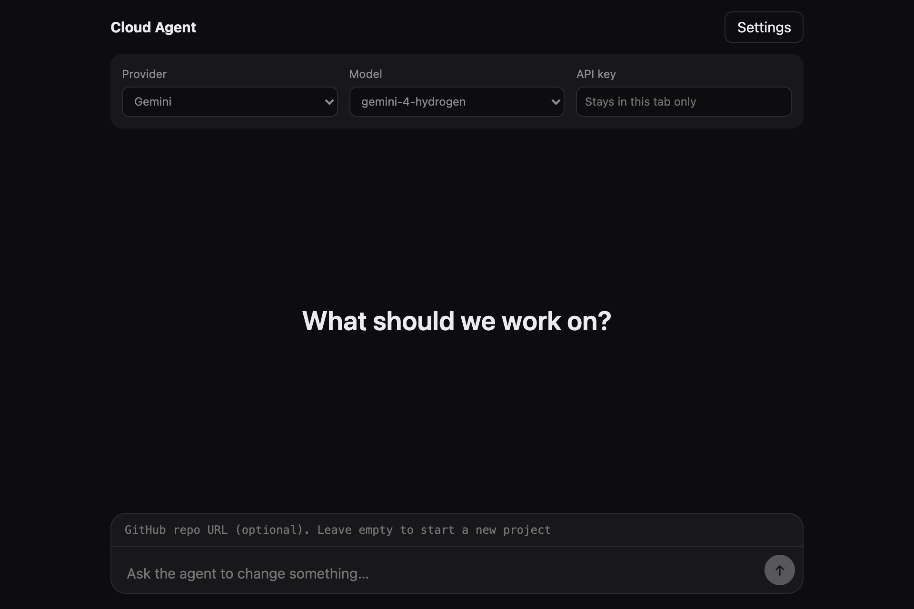
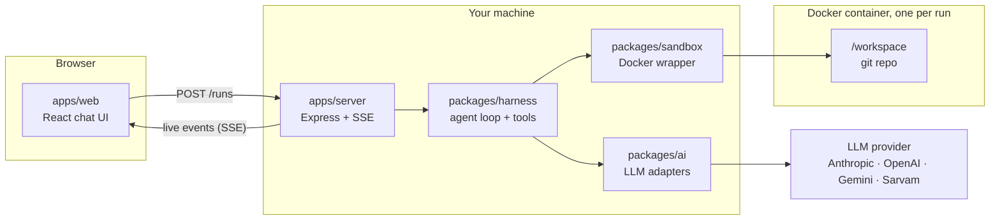
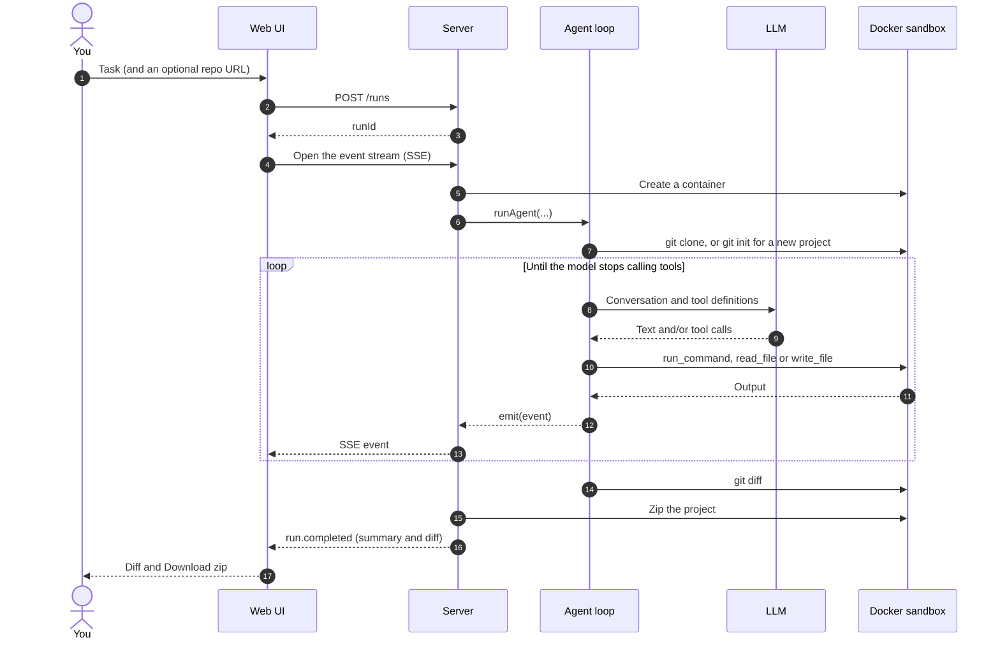
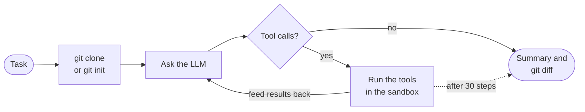
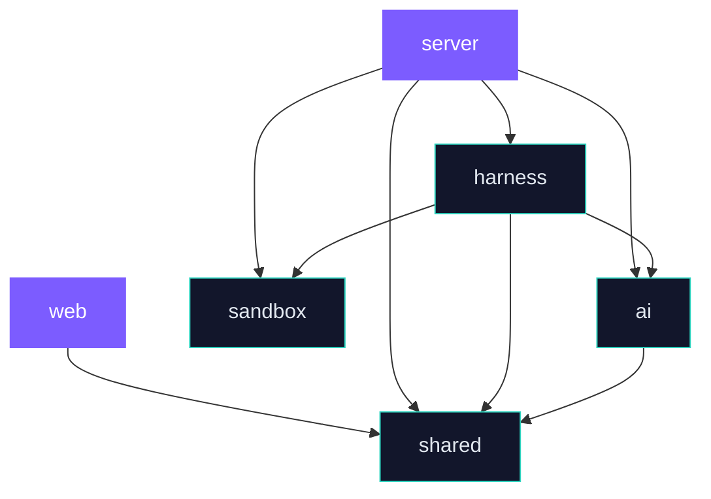

<p align="center">
  
</p>

<p align="center">
  
  
  
  
  
  
</p>

<p align="center">
  <b>Give it a task, and optionally a GitHub repo.</b><br>
  An AI agent works inside a throwaway Docker container while you watch every command, edit and diff stream in live.<br>
  Then review the changes and download the result as a zip.
</p>

<p align="center">
  <a href="#quick-start">Quick start</a> ·
  <a href="#how-it-works">How it works</a> ·
  <a href="#pick-your-model">Models</a> ·
  <a href="#project-layout">Layout</a> ·
  <a href="#api">API</a> ·
  <a href="#safety-and-limits">Safety</a>
</p>

---

## See it work

<p align="center">
  
</p>

<!-- <table>
  <tr>
    <td width="50%"></td>
    <td width="50%"></td>
  </tr>
  <tr>
    <td align="center"><sub><b>Live.</b> Commands stream their output as they run.</sub></td>
    <td align="center"><sub><b>Your choice.</b> Pick a provider and model, paste a key.</sub></td>
  </tr>
</table> -->

<sub>Screenshots are the real UI driven by a scripted demo run.</sub>

## Features

| Feature | What you get |
|---|---|
| **Chat interface** | Your task is a message. The agent replies with text, commands, edits and a final summary. |
| **Start from scratch or from a repo** | Paste a GitHub URL to work on existing code, or leave it empty to build a new project. |
| **Live terminal output** | Commands run in a sandbox and stream back as they execute. Reconnect any time and the server replays what you missed. |
| **Per-file diffs** | Every change is shown as a diff with `+` / `−` counts, one collapsible block per file. |
| **One-click download** | Get the finished project as a zip (without `.git` or `node_modules`). |
| **Four LLM providers** | Anthropic, OpenAI, Gemini and Sarvam, each with its own model list. |
| **Cancel any time** | The stop button destroys the container and ends the run. |
| **Sandboxed** | Every run gets its own container with CPU, memory and process limits, and it runs as a normal user. |

## Quick start

You need **Node 22+**, **pnpm** and **Docker** (running).

```bash
pnpm install
pnpm sandbox:build   # builds the sandbox image, once
pnpm dev             # server on :3001, web on :5173
```

Open **http://localhost:5173**, open **Settings**, choose a provider and model, paste your API key, then describe a task.

> [!TIP]
> Not sure what to ask first? Try: *"Create a single file index.html with a heading and a button that counts clicks."*

## How it works

The browser talks only to the **server**. The server runs the **agent loop** and streams everything the agent does back as events.



### One run, step by step



### Inside the agent loop

The loop is about 70 lines in [`packages/harness/src/index.ts`](packages/harness/src/index.ts). The model has four tools: `run_command`, `read_file`, `write_file` and `edit_file`. When it replies without calling a tool, it is done.



## Pick your model

Choosing a provider switches the model list. The lists live in one place, [`packages/shared/src/index.ts`](packages/shared/src/index.ts), and the server rejects any model that doesn't belong to the chosen provider.

| Provider | Models (first is the default) |
|---|---|
| **Anthropic** | `claude-sonnet-5-5` · `claude-opus-5-5` · `claude-haiku-5-5` |
| **OpenAI** | `gpt-6.2-sol` · `gpt-6.2-astra` · `gpt-6.1-terra` · `gpt-6-luna` |
| **Gemini** | `gemini-4-hydrogen` · `gemini-4-argon` · `gemini-4-carbon` · `gemini-3.8-flash` · `gemini-3.6-flash` |
| **Sarvam** | `sarvam-105b` · `glm5.3` · `glm5.3-flash` · `gemma4` · `deepseekv4.1-flash-1017` |

Sarvam is reached through its OpenAI-compatible endpoint, so it reuses the OpenAI adapter.

> [!NOTE]
> On a small credit balance? `sarvam-105b` is the cheapest model in the list.

## Project layout

```
cloud-agent/
├─ apps/
│  ├─ web/             React chat UI: composer, live thread, diff, download
│  └─ server/          Express: routes, in-memory runs, SSE with replay
├─ packages/
│  ├─ shared/          Event types, API types, the model lists
│  ├─ ai/              One chat() interface over four providers
│  ├─ sandbox/         Docker container: exec, read/write files, download, destroy
│  └─ harness/         The agent loop and its tools
└─ docker/
   └─ sandbox.Dockerfile
```

Each package owns one job and knows nothing about the layers above it. Only the server knows what SSE is, so the agent loop can also run from a plain script.



There is **no build step**. Packages export their `src/index.ts` directly and `tsx` and Vite compile it on the fly, so a change in any package shows up immediately.

## API

| Method | Path | What it does |
|---|---|---|
| `POST` | `/runs` | Start a run. Body: `{ task, provider, model, apiKey, repoUrl?, chatId? }`. Pass `chatId` to continue a saved chat. Returns `{ runId, chatId }`. |
| `GET` | `/chats` | The saved chats, newest first: `[{ id, title }]`. |
| `GET` | `/chats/:id` | One chat's events, so the page can show it again. |
| `GET` | `/runs/:id/events` | Server-sent events. A reconnecting client sends `Last-Event-ID` and gets only what it missed. |
| `POST` | `/runs/:id/cancel` | Stop the run and destroy its container. |
| `GET` | `/runs/:id/download` | The finished project as `result.zip`. |

Everything a run does arrives as one of these events:

| Event | Meaning |
|---|---|
| `run.started` · `sandbox.ready` | The run exists and its container is up. |
| `clone.done` | The repo was cloned (`fileCount`). Skipped for new projects. |
| `agent.message` | Text from the model. |
| `tool.call` · `tool.result` | The model called a tool, and what came back. |
| `terminal.output` | A chunk of live command output. |
| `file.changed` | The agent wrote a file. |
| `run.completed` | Finished, with a `summary` and the full `diff`. |
| `run.failed` | Something went wrong, or the run was cancelled. |

## Safety and limits

| Protection | How it works |
|---|---|
| **Isolation** | One container per run: 1 GB memory, 1 CPU, 256 processes, running as a non-root user. |
| **Timeouts** | 120 s per command (300 s for the clone). The timeout runs inside the container, so it really stops the command. |
| **Output** | At most 1 MB captured per command, and 10,000 characters sent back to the model (start and end kept). |
| **Step cap** | 30 model turns per run. |
| **Auto-cleanup** | Containers are removed on completion or cancel, and expire by themselves after one hour. |
| **API keys** | Held in the browser tab's memory and in the running request. Never written to disk or logged. |

> [!WARNING]
> The server has **no login**, and sandboxed containers **can reach the network** (needed for `git clone` and `npm install`). Run it on your own machine, or put your own authentication in front of it before you share it.

## Try it without the UI

```bash
# Smoke test: real container, scripted fake model, no API key needed
pnpm --filter @agent/harness check

# Run the agent straight from the terminal
API_KEY=sk-... pnpm --filter @agent/harness cli https://github.com/user/repo "add a README"
API_KEY=sk-... pnpm --filter @agent/harness cli "build a todo app in plain HTML"   # no repo
```

Set `PROVIDER` (`anthropic`, `openai`, `gemini` or `sarvam`) and `MODEL` to switch models.

## Status and ideas

- Verified: it typechecks cleanly, and the smoke test passes with and without a repo.
- Verified: every provider adapter reaches its API and fails cleanly on a bad key.
- Not verified yet: runs end to end with every provider's real key. Try yours and see.
- Ideas: follow-up messages that continue in the same container, run history that survives a restart, login, and a network-restricted sandbox.

Each run is independent today. Sending a new message starts a fresh container rather than continuing the last one.

## Saved chats

Every chat is saved, so you can close the tab and continue later.

- **Neon** (`packages/db`, through Prisma) keeps the chat: the events the page shows, and the messages the model has seen. Tables are defined in `packages/db/prisma/schema.prisma`; after changing it, run `pnpm --filter @agent/db db:push`.
- **Cloudflare R2** (`packages/cloud`) keeps the files: a `tar.gz` of the sandbox (with `.git`, without `node_modules`) at `chats/<chatId>/workspace.tar.gz`.

When you send a message in a saved chat, the server starts a fresh sandbox, unpacks the snapshot, and gives the model its old messages plus the new task. API keys are never saved, so enter yours in Settings again after a reload.

Set these in `.env` (local) or `/etc/cloud-agent.env` (server):

```
DATABASE_URL=postgresql://...neon.tech/neondb?sslmode=require
R2_ACCOUNT_ID=...
R2_ACCESS_KEY_ID=...
R2_SECRET_ACCESS_KEY=...
R2_BUCKET=...
```
